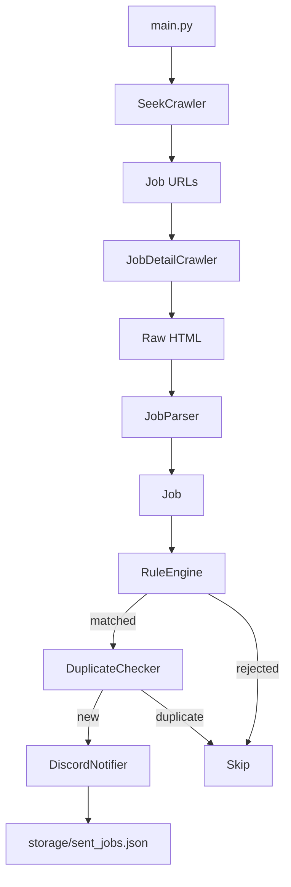

# AI Job Agent

An automated job scraping agent that monitors Seek Australia, filters listings against configurable rules, and sends Discord notifications for new matches.

## Features

- **Seek URL crawler** — collects job detail URLs from a configurable search page
- **Job detail fetcher** — downloads raw HTML with Playwright (browser reuse + retries)
- **HTML parser** — converts Seek job pages into structured `Job` objects
- **Rule engine** — filters by title, blocked keywords, location, and experience
- **Duplicate detection** — tracks sent jobs in `storage/sent_jobs.json`
- **Discord notifier** — sends plain-text alerts for matched new jobs
- **Run summary** — prints crawl, match, duplicate, and notification statistics

## Architecture



## Project Structure

```
jobscraping_aiagent/
├── main.py                 # Pipeline entry point
├── config.py               # Environment configuration + validation
├── requirements.txt
├── .env.example
├── crawler/
│   ├── base.py             # Abstract base crawler
│   ├── seek.py             # Seek search results crawler
│   ├── job_detail.py       # Job detail HTML fetcher
│   └── linkedin.py         # LinkedIn stub (future)
├── parser/
│   └── parser.py           # HTML → Job parser
├── rules/
│   ├── engine.py           # Rule engine
│   └── rule_config.py      # Filter configuration
├── notifier/
│   └── discord.py          # Discord webhook notifier
├── storage/
│   ├── duplicate_checker.py
│   └── sent_jobs.json      # Persisted notified job URLs
├── models/
│   └── job.py              # Job dataclass
├── utils/
│   └── logger.py           # Shared logger
├── tests/
│   └── test_rule_engine.py # Manual rule engine test harness
└── logs/                   # Runtime logs (gitignored)
```

## Requirements

- Python 3.12+
- macOS, Linux, or Windows
- A Discord webhook URL

## Installation

Clone the repository and set up a virtual environment:

```bash
git clone <repository-url>
cd jobscraping_aiagent
python3 -m venv .venv
source .venv/bin/activate
pip install -r requirements.txt
python -m playwright install chromium
cp .env.example .env
```

Edit `.env` and set your Discord webhook URL.

## Environment Variables

| Variable | Required | Default | Description |
|---|---|---|---|
| `DISCORD_WEBHOOK` | Yes | — | Discord webhook URL for job notifications |
| `HEADLESS` | No | `true` | Run Playwright in headless mode |
| `PLAYWRIGHT_TIMEOUT` | No | `30000` | Browser timeout in milliseconds |

Job filter rules are configured in `rules/rule_config.py` (allowed titles, blocked titles, locations, max experience).

The Seek search URL is configured in `config.py` (`SEEK_SEARCH_URL`).

## Running Locally

Always activate the virtual environment first:

```bash
source .venv/bin/activate
python main.py
```

Or use the helper script (automatically uses `.venv`):

```bash
./run.sh
```

Expected flow:

1. Crawl job URLs from Seek
2. Fetch and parse each job
3. Evaluate against the rule engine
4. Send Discord notifications for new matched jobs
5. Print a run summary

If `DISCORD_WEBHOOK` is missing, the app exits with a clear error:

```text
ERROR

DISCORD_WEBHOOK is not configured.

Please create a .env file based on .env.example.
```

## Running Tests

Manual rule engine integration test (no pytest required):

```bash
source .venv/bin/activate
python tests/test_rule_engine.py
```

## Duplicate Detection

On the first run, matched jobs are sent to Discord and their URLs are saved to `storage/sent_jobs.json`.

On subsequent runs, previously notified jobs are skipped automatically.

## Troubleshooting

| Problem | Solution |
|---|---|
| `ModuleNotFoundError: No module named 'playwright'` | Activate `.venv` before running, then `pip install -r requirements.txt` |
| `Executable doesn't exist` (Playwright) | Run `python -m playwright install chromium` inside the venv |
| `DISCORD_WEBHOOK is not configured` | Copy `.env.example` to `.env` and add your webhook URL |
| Playwright install fails with shell comments | Run commands without inline comments (e.g. avoid `# first time only`) |

## Roadmap

- [x] GitHub Actions manual workflow
- [ ] LinkedIn crawler
- [ ] GitHub Actions scheduled runs
- [ ] SQLite storage backend
- [ ] Rich Discord embeds
- [ ] Multi-search URL support

## GitHub Actions

Run the pipeline manually from the Actions tab:

1. Add repository secret `DISCORD_WEBHOOK` with your webhook URL
2. Go to **Actions** → **Crawl Jobs** → **Run workflow**

The workflow uses `workflow_dispatch` only (no scheduling yet).
# JobScraping_Agent
